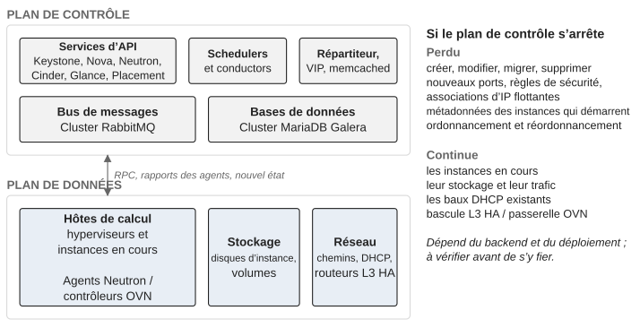

*Partie I — Comprendre le problème*

# Chapitre 1 — OpenStack ne s’arrête pas au déploiement

Un projet de déploiement a une fin naturelle. L’infrastructure est prête, les services OpenStack sont déployés, la validation est terminée, la documentation est livrée, et l’équipe projet passe à son objectif suivant. La production ne connaît pas cette frontière. Dès que des charges de travail dépendent d’OpenStack, l’organisation entre dans une phase où la plateforme est une capacité opérationnelle permanente, et cette phase n’a pas de date de fin. Les praticiens l’appellent Day 2, le « jour 2 » : tout ce qui se passe après que la plateforme a été construite (Day 1) et qu’elle porte des charges de travail qui comptent. Ce livre emploie le terme dans ce sens d’un bout à l’autre.

La transition vers le Day 2 est régulièrement sous-estimée, et elle tend à échouer d’une manière reconnaissable. Les ingénieurs qui ont construit la plateforme restent responsables des incidents, des changements et du support parce qu’ils connaissent le mieux l’architecture, si bien qu’ils deviennent le point d’escalade par défaut pour tout. L’organisation croit avoir créé un modèle d’exploitation alors qu’elle a en réalité prolongé l’équipe de déploiement en production. Les experts sont chers et rares, et leur temps est nécessaire à l’architecture, aux mises à niveau et aux décisions d’ingénierie difficiles ; au lieu de quoi il est consommé par du support répétitif. Pendant ce temps, l’organisation d’exploitation au sens large ne développe jamais de compétence OpenStack, parce que les experts restent les seules personnes à qui l’on fait confiance pour intervenir.

La solution consiste à répartir le travail d’exploitation selon le risque, et non à retirer les experts de l’exploitation. Les actions routinières, bien comprises et réversibles peuvent progressivement migrer vers l’exploitation de premier niveau, l’équipe qui reçoit les signalements des utilisateurs et traite les situations connues à partir de procédures ; le diagnostic complexe et les changements de plateforme restent à l’équipe spécialisée. La frontière doit être tracée selon la conséquence et l’expertise requise, pas selon la commodité organisationnelle. Un test utile pour toute opération est de se demander si elle exige une expertise de la plateforme ou une procédure fiable. Un diagnostic en lecture seule qui peut être exécuté sans danger à partir d’une procédure documentée ne devrait pas avoir besoin de l’ingénieur OpenStack le plus expérimenté de l’entreprise, et chaque opération de ce type qui migre vers le support de premier niveau crée de la capacité là où elle est la plus rare.

## Deux cycles de vie, une plateforme

La plateforme a deux cycles de vie entrelacés. Le **cycle de vie de livraison** couvre les fonctionnalités, les mises à niveau, les intégrations, l’architecture et les améliorations. Le **cycle de vie opérationnel** couvre les incidents, la maintenance, l’application des correctifs, la capacité, la reprise, la supervision et le support. Ce sont deux dimensions de la même plateforme, et chacune échoue sans l’autre : une équipe qui livre en continu sans capacité opérationnelle finit par créer de l’instabilité, et une équipe qui ne fait que protéger l’état existant finit par créer une plateforme vieillissante que personne n’ose toucher. Le Day 2 exige un équilibre explicite entre les deux, décidé plutôt que laissé à qui crie le plus fort.

La tension entre les deux vient généralement d’objectifs locaux incompatibles. La livraison veut introduire de la capacité ; l’exploitation, que beaucoup d’organisations appellent le RUN, veut préserver la qualité de service. Les deux sont légitimes, et les ennuis commencent quand on les traite comme des systèmes séparés. Une plateforme OpenStack de production ne peut pas être divisée en « la partie que nous changeons » et « la partie que nous exploitons » : un changement dans Nova devient une préoccupation d’exploitation, un problème d’exploitation récurrent devient une préoccupation d’architecture, une exigence de sécurité devient un problème de capacité, un incident révèle une capacité produit manquante. La réponse pratique est de donner aux deux côtés une vision partagée des conséquences. Un changement proposé devrait répondre à au moins quatre questions : quelle capacité crée-t-il ou protège-t-il, quelle capacité existante pourrait-il affecter, quelle charge opérationnelle ajoute-t-il, et que faudra-t-il pour l’exploiter une fois l’équipe de livraison passée à autre chose. Cela compte dans OpenStack parce que les frontières entre services ne sont pas des frontières métier. Un changement qui paraît local à Nova peut atteindre Placement, Neutron, le bus de messages, la base de données, les hyperviseurs et les propres flux de travail des consommateurs.

## Le Day 2 est une plateforme en mouvement

Le Day 2 est souvent réduit au maintien des services en fonctionnement, et cette définition est trop étroite, parce qu’une plateforme OpenStack n’est jamais immobile. Les charges de travail changent, la capacité change, les versions vieillissent, les exigences de sécurité évoluent, le matériel est remplacé, les dépendances reçoivent des correctifs, les consommateurs demandent de nouvelles capacités et les équipes changent. La plateforme doit être exploitée *tout en* changeant, ce qui est un problème différent de l’exploitation d’un système statique. L’exploitation, en ce sens, est la capacité qui permet au changement de se produire sans détruire l’état de confiance dont dépend l’entreprise, et une manière utile de tenir les deux idées ensemble est de distinguer **protéger l’état actuel** et **créer l’état suivant**. Les deux sont nécessaires, et ils se disputent les mêmes personnes, les mêmes fenêtres de maintenance et les mêmes ressources.

La production change aussi les règles de l’ingénierie. En laboratoire, un ingénieur peut reconstruire un environnement pour le comprendre. En production, l’état existant contient des charges de travail critiques et une histoire qu’on ne peut pas simplement jeter, si bien qu’un changement doit être jugé non seulement sur son fonctionnement mais sur la possibilité de le rétablir. Et chaque changement consomme une ressource finie. Les fenêtres de maintenance sont finies. Les ingénieurs sont finis. La capacité de calcul nécessaire à la migration à chaud, l’opération qui déplace une instance en fonctionnement d’un hyperviseur à un autre, est finie. L’attention disponible pour les incidents, les mises à niveau et la documentation est finie. Ce livre appelle cette ressource la **capacité de changement**, et la traite comme une contrainte réelle plutôt que comme un désagrément de planification : les fenêtres de maintenance sont en concurrence avec les mises à niveau, le travail de sécurité avec la livraison de fonctionnalités, les exercices de reprise avec la réponse aux incidents, et les ingénieurs ne peuvent pas exécuter un nombre illimité de changements simplement parce que le backlog les contient. Il en découle une discipline que je tiens pour l’une des plus précieuses du travail Day 2 : prioriser les changements qui améliorent la capacité de la plateforme à absorber les changements futurs. Une simplification qui supprime une charge opérationnelle récurrente peut valoir plus qu’une fonctionnalité de plus. Un exercice de reprise peut avoir plus de valeur à long terme qu’une optimisation à faible risque. Réduire la divergence locale par rapport à upstream peut rendre la prochaine mise à niveau nettement plus sûre.

Le coût d’un changement, du reste, a peu à voir avec le nombre de commandes qu’il requiert. Une opération de maintenance peut être routinière d’un point de vue technique et consommer malgré tout une capacité de changement réelle. Un correctif de sécurité peut exiger des migrations à chaud. Une modification réseau peut affecter plusieurs services à la fois. Une mise à niveau peut exiger des changements entièrement en dehors d’OpenStack. Ce qui détermine le coût, c’est le rayon d’impact (quelle part de la plateforme et combien de charges de travail une défaillance du changement atteindrait), l’incertitude, la capacité de reprise, les dépendances, la criticité métier et la capacité disponible à ce moment-là.

## La dégradation contrôlée

La stabilité ne doit pas être confondue avec le gel de la plateforme. Les états connus sont le fondement du changement sûr : quand les ingénieurs comprennent à quoi ressemble un environnement sain, les écarts deviennent détectables, et quand les procédures de reprise ont été testées contre un état connu, la réponse aux incidents dépend moins de l’improvisation. Ce livre appelle un tel état un **état de confiance** : un état dont le comportement, les dépendances et les caractéristiques de reprise sont suffisamment connus pour qu’on puisse s’y fier.

La dégradation contrôlée découle de la même idée, et l’architecture d’OpenStack lui donne une base inhabituellement solide. Supposons que le plan de contrôle devienne instable. L’organisation peut décider de cesser d’accepter de nouvelles opérations sur les ressources tout en protégeant les charges de travail qui tournent déjà. C’est souvent préférable à laisser un plan de contrôle instable continuer d’accepter des requêtes qui rendent la reprise plus difficile. L’entreprise n’a pas besoin que toutes les capacités soient disponibles à tout instant ; elle a besoin que les capacités qui comptent le plus restent protégées.

> **Note technique — le plan de contrôle et le plan de données tombent en panne séparément.** Dans OpenStack, le plan de contrôle (les services d’API, les schedulers, les conductors, le bus de messages et les bases de données) est distinct du plan de données (les hyperviseurs qui exécutent les machines virtuelles, leurs disques et leurs chemins réseau). Si les services d’API, le bus de messages ou les bases de données sont arrêtés ou dégradés, les instances existantes continuent de tourner, gardent leur stockage et continuent d’échanger du trafic. Ce qui est perdu, c’est la possibilité de créer, modifier, migrer ou supprimer des ressources, et la propagation du *nouvel* état vers le plan de données : un nouveau port, une règle de groupe de sécurité modifiée ou une IP flottante nouvellement associée ne prendront effet qu’au retour du plan de contrôle, et une instance qui démarre pendant l’interruption peut ne pas atteindre le service de métadonnées. Les fonctions implémentées sur les nœuds du plan de données eux-mêmes survivent en général : avec la configuration courante ML2/OVS, les baux DHCP existants continuent d’être servis par le dnsmasq de l’agent DHCP tant que son hôte tourne, et avec OVN, le DHCP est servi localement sur chaque nœud de calcul ; la bascule des routeurs avec L3 HA (keepalived) ou les gateway chassis OVN est un mécanisme du plan de données qui n’a pas besoin de l’API. Deux précautions s’imposent. Les agents Neutron et les contrôleurs OVN tournent *sur* les nœuds du plan de données, si bien qu’en redémarrer certains, selon la version et la configuration, peut interrompre brièvement le trafic ; « arrêter le plan de contrôle » doit signifier les API, le bus et les bases de données, pas les agents. Et le comportement exact dépend du backend réseau et du déploiement, et doit être vérifié pour chaque plateforme avant qu’on s’y fie pendant un incident. Voir la documentation de l’architecture de Nova et la documentation de Neutron sur les agents et sur OVN.

Cette séparation (figure 1.1) est ce qui fait d’« arrêter les API, protéger les charges de travail en cours » une option crédible plutôt qu’un euphémisme pour une panne. Le chapitre 19 la montre utilisée pendant un incident.

Deux machines virtuelles peuvent paraître identiques à l’infrastructure alors que leurs conséquences métier sont complètement différentes. L’organisation a donc besoin d’un moyen de traduire l’état technique en criticité métier, et elle a besoin de cette traduction *avant* l’incident. Le chapitre 20 montre ce qui arrive quand elle manque pendant une campagne d’application de correctifs.

*Figure 1.1 : Le plan de contrôle et le plan de données tombent en panne séparément : ce qui s’arrête et ce qui continue quand les services d’API, le bus de messages et les bases de données sont indisponibles.*

## La stabilité a un coût en capacité

Si toute la capacité d’ingénierie est consommée par les incidents et la maintenance urgente, l’organisation cesse de documenter, de former, de tester la reprise et de réduire la dette. La plateforme peut rester opérationnelle tout en devenant moins durable chaque mois. La stabilité est une capacité organisationnelle autant qu’une propriété de l’infrastructure, et une plateforme qui exige un héroïsme permanent pour rester stable n’est pas stable du tout.

La tentation de tout réparer doit aussi être combattue. Tous les problèmes ne méritent pas une remédiation immédiate. Une partie de la dette technique est connue et contrôlée ; certaines imperfections à faible impact coûtent moins cher à porter qu’à supprimer ; certaines transformations créent plus de risque que le problème qu’elles devaient résoudre. La question à poser à propos de toute amélioration est de savoir si la faire *maintenant* réduit plus de risque qu’elle n’en introduit.

## La passation est une transition de capacité

Le passage du déploiement à l’exploitation doit être traité comme un transfert de capacité, pas comme un jalon de projet. L’équipe de déploiement sait peut-être pourquoi une topologie RabbitMQ particulière a été choisie, pourquoi le comportement de la base de données est supervisé d’une certaine manière, pourquoi certains réglages de Nova sont délibérément contraints, ou pourquoi une dépendance réseau est considérée comme critique. Rien de cette connaissance n’est transféré parce qu’un runbook existe. La question plus difficile à laquelle une passation doit répondre est de savoir si l’organisation qui reçoit la plateforme peut prendre une décision sûre sans la présence de l’équipe de déploiement.

Cela inclut les décisions routinières autant que les incidents. L’équipe d’exploitation doit savoir quels symptômes peuvent être traités localement, lesquels exigent une escalade, quelles preuves doivent être collectées avant d’escalader, et quelles actions sont explicitement interdites. Les ingénieurs plateforme doivent rester disponibles pour les problèmes difficiles, mais comme capacité d’escalade, pas comme modèle d’exploitation lui-même. À grande échelle, le point devient inévitable : une plateforme qui sert des centaines ou des milliers de charges de travail ne peut pas être exploitée en traitant chaque événement comme une consultation d’expert. Il lui faut un modèle gradué dans lequel les signaux routiniers sont filtrés, les actions courantes sont standardisées et l’expertise rare est réservée aux situations où elle apporte une valeur disproportionnée.

Le premier modèle d’exploitation n’a pas besoin d’être parfait, mais il doit exister avant le premier jour de production. L’organisation doit savoir quelle équipe reçoit un signalement d’utilisateur, quelle équipe peut inspecter la plateforme, quelles actions sont routinières, lesquelles exigent une intervention de spécialiste, et qui peut autoriser une reprise perturbatrice. Cela compte dans OpenStack parce que la propriété apparente est trompeuse : une équipe plateforme peut être propriétaire de Nova tandis qu’une autre équipe est propriétaire des hyperviseurs, une autre du réseau physique et une autre de l’infrastructure de bases de données. Un incident ne respecte pas ces frontières, si bien que le modèle d’exploitation a besoin d’un chemin explicite à travers elles. Une répétition simple révèle s’il existe. Un utilisateur ne peut pas créer de machine virtuelle. Qui reçoit la demande ? Quelles preuves sont collectées ? Quels services sont vérifiés ? Qui enquête sur Placement ou Neutron ? Qui décide si une API doit être restreinte ? Qui parle au consommateur ? Si ces questions produisent des réponses différentes selon qui se trouve disponible, la plateforme n’est pas prête pour l’exploitation, quoi qu’en disent les tests d’acceptation.

« Tout est au vert » n’est pas non plus une définition utile d’une plateforme OpenStack saine. Un déploiement peut passer ses tests d’acceptation alors que l’organisation reste impréparée à la production : un service peut démarrer correctement sans que personne sache comment il se comporte sous charge, une migration peut réussir sans qu’il y ait la capacité pour un événement de maintenance complet, une fonctionnalité peut marcher sans procédure de reprise documentée. L’organisation doit savoir ce que signifie une exploitation de confiance pour ses capacités critiques, telles que le provisionnement de VM, la connectivité des tenants, les opérations sur les volumes, l’authentification, la migration des charges de travail et la reprise. Sans ces définitions, la stabilité est une collection de contrôles de santé plutôt qu’une condition qui a un sens pour le métier. C’est aussi pourquoi les futurs opérateurs doivent être impliqués avant la fin du Day 1 : ils ont besoin de visibilité sur la conception, pas seulement d’un dossier de passation, et ils doivent savoir lesquelles des hypothèses des concepteurs sont assez importantes pour devenir des contraintes d’exploitation.

## L’équipe de déploiement ne doit pas devenir une dépendance permanente

Les meilleures équipes de déploiement créent leur propre risque opérationnel précisément parce qu’elles sont bonnes. Elles connaissent l’architecture mieux que quiconque, elles résolvent les incidents vite, et elles se souviennent des raisons derrière les décisions inhabituelles, si bien que l’organisation devient réticente à leur retirer la responsabilité. C’est compréhensible et dangereux. Le but de l’expertise devrait être de rendre l’organisation moins dépendante de cette expertise pour l’exploitation routinière, tandis que les experts restent disponibles pour les décisions à forte conséquence et les problèmes d’ingénierie difficiles.

> **Principe.** La mesure d’un déploiement réussi est que la plateforme reste exploitable quand les experts du déploiement ne sont plus là.

Le déploiement est le moment où commence la responsabilité à long terme de l’organisation envers la plateforme, et le premier objectif opérationnel est de construire une organisation capable d’exploiter ce qui a déjà été construit.

---

[← Introduction](00-introduction.md) · [Sommaire](../README.md) · [Chapitre 2 — L’ennemi, c’est la perte de contrôle →](02-l-ennemi-c-est-la-perte-de-controle.md)
