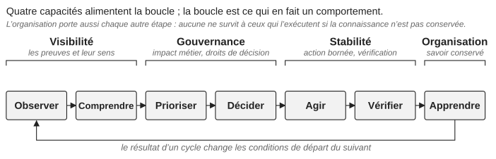

*Partie I — Comprendre le problème*

# Chapitre 4 — La boucle de contrôle

Les quatre capacités deviennent un comportement opérationnel à travers une boucle qui relie des activités que la plupart des organisations exécutent déjà :

**Observer** → **Comprendre** → **Prioriser** → **Décider** → **Agir** → **Vérifier** → **Apprendre**

Les lecteurs qui connaissent le cycle planifier–faire–vérifier–agir ou la boucle observer–s’orienter–décider–agir en reconnaîtront la forme ; la boucle ne prétend à aucune nouveauté. Sa valeur dans ce livre est de nommer l’étape le plus souvent sautée sur une plateforme sous pression, et de montrer où chacune des quatre capacités fait son travail (figure 4.1).

*Figure 4.1 : Les quatre capacités et les étapes de la boucle de contrôle qu’elles alimentent.*

OpenStack produit beaucoup de signaux, et une création de VM échouée peut impliquer plusieurs services et dépendances à la fois. La visibilité fournit des preuves, mais les preuves ne sont pas la compréhension. La compréhension identifie les hypothèses et les contraintes significatives. La priorisation introduit l’impact métier. Les droits de décision, l’autorité explicite de prendre une décision et d’en accepter la conséquence, déterminent qui choisit parmi les options. L’action doit rester dans des limites comprises. La vérification établit si le résultat visé a été atteint, parce que le succès technique n’est pas le succès du service : une migration à chaud réussie ne prouve pas que le problème de performance qu’elle devait résoudre a disparu. L’apprentissage convertit le résultat en capacité organisationnelle.

## La boucle opère à plusieurs échelles de temps

L’exploitation l’utilise en continu. La gestion des changements l’utilise pendant les transitions contrôlées. L’évolution l’utilise sur des périodes de cycle de vie qui se mesurent en années. Un ingénieur d’exploitation peut découvrir un problème récurrent aujourd’hui ; l’équipe plateforme le traite au prochain cycle de maintenance ; l’architecture supprime la dépendance sous-jacente à la prochaine mise à niveau. Ce sont des échelles de temps différentes de la même boucle, et la valeur du cadre vient de ce qu’il les relie. La boucle est aussi un système de rétroaction : une reprise échouée améliore la documentation, un incident récurrent change l’observabilité, une mise à niveau difficile motive une simplification, un changement d’équipe révèle une dépendance à une connaissance. Sans cette rétroaction, l’organisation résout sans cesse des symptômes.

## Où la boucle se rompt

Quand le contrôle s’affaiblit, l’étape rompue est généralement visible : observer sans comprendre, comprendre sans décider, décider sans la capacité d’agir, agir sans vérifier, apprendre sans retenir. La dernière est la défaillance la plus silencieuse. L’apprentissage qui reste chez les personnes impliquées disparaît quand elles partent, si bien que la boucle doit se terminer par quelque chose de retenu : de la documentation, de la propriété, de la formation, de la mesure ou un changement de la plateforme. C’est ce qui la rend organisationnelle plutôt que procédurale.

## La boucle est faite pour les situations ambiguës

Une demande de routine passe de l’observation à l’action en quelques minutes et n’a besoin d’aucune cérémonie. La boucle gagne sa place quand la réponse n’est pas évidente. Un signal initial suggère un problème Nova ; l’enquête révèle des anomalies de messagerie ; d’autres preuves montrent que la base de données est touchée aussi ; l’impact métier change parce que les charges de travail existantes restent disponibles tandis que le nouveau provisionnement est bloqué. La décision n’est plus « réparer Nova ». Elle devient « protéger l’état de confiance de la plateforme en acceptant une perte temporaire de la capacité de provisionnement », et la boucle est ce qui permet à l’organisation de changer sa décision à mesure que les preuves changent. Le chapitre 19 suit une séquence très proche de celle-ci à travers un incident réel.

La boucle doit donc fonctionner à vitesse humaine. Un cadre devient inutile s’il exige une réunion pour chaque décision. Il doit être léger pour le travail de routine et de plus en plus explicite à mesure que la conséquence et l’incertitude augmentent ; cette proportionnalité est ce qui sépare le contrôle de la bureaucratie. L’apprentissage, à son tour, doit changer quelque chose : une revue d’incident qui ne produit qu’un rapport a peu de valeur. Si rien ne change après un incident, l’organisation doit être capable d’expliquer pourquoi les contrôles existants étaient déjà suffisants.

Le contrôle exige aussi de la capacité : quand les incidents et la maintenance consomment tout le temps d’ingénierie disponible, la boucle perd silencieusement ses deux dernières étapes. Une organisation OpenStack mature n’a pas éliminé les comportements inattendus. C’est une organisation dans laquelle les ingénieurs peuvent enquêter sans deviner, où les décisions ont des propriétaires clairs, où les changements s’exécutent dans des limites comprises, et où la connaissance opérationnelle survit aux individus qui l’ont acquise.

---

[← Chapitre 3 — Pourquoi de bonnes plateformes deviennent difficiles à exploiter](03-pourquoi-de-bonnes-plateformes-deviennent-difficiles-a-exploiter.md) · [Sommaire](../README.md) · [Chapitre 5 — Évaluer le contrôle de la plateforme →](05-evaluer-le-controle-de-la-plateforme.md)
