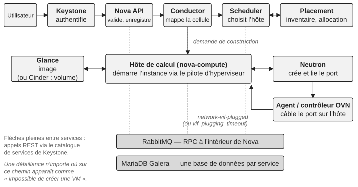

*Partie II — Évaluer le contrôle*

# Chapitre 5 — Évaluer le contrôle de la plateforme

Avant de modifier un environnement OpenStack difficile, l’organisation doit savoir où elle en est. L’évaluation doit commencer par ce dont l’activité dépend, pas par la liste des composants. Une chaîne utile suit la conséquence d’une défaillance à travers la plateforme :

**Capacité métier** → **Capacité OpenStack** → **Service de la plateforme** → **Dépendance technique** → **Équipe** → **Expertise** → **Capacité de reprise**

Une capacité métier dépend, disons, du provisionnement de VM. Cette capacité met en jeu Nova et Placement, mais aussi Keystone, Glance, Neutron, le bus de messages, les bases de données, le stockage et l’infrastructure sous-jacente. Il faut ensuite identifier qui est propriétaire de chaque dépendance, qui peut la diagnostiquer et qui peut la rétablir. L’impact métier passe en premier : un composant très complexe qui soutient une capacité non critique peut demander moins d’attention immédiate qu’une dépendance simple qui soutient une charge de travail critique.

> **Note technique — ce que traverse réellement la création d’une VM.** Une demande de création de serveur est authentifiée par Keystone et reçue par l’API Nova, qui la valide, enregistre la demande dans la base de données de l’API et confie la construction au conductor, le service Nova qui coordonne les opérations en plusieurs étapes et sert d’intermédiaire aux computes pour l’accès à la base de données. Le scheduler choisit un hôte, en s’appuyant sur Placement pour trouver les resource providers disposant de l’inventaire requis et pour réserver l’allocation. Tout déploiement a au moins une cellule (Nova cells v2), et le conductor associe l’instance à la cellule dont la base de données la contiendra ; un hôte qui existe mais n’a pas été associé à une cellule avec `nova-manage cell_v2 discover_hosts` fait échouer les constructions avec « host is not mapped to any cell », cause classique du « la capacité existe mais rien n’y est placé ». Le service compute sélectionné récupère l’image auprès de Glance (ou, pour un démarrage depuis un volume, demande le volume à Cinder), demande à Neutron de créer et de lier le port, et ordonne au pilote de l’hyperviseur de démarrer l’instance. Le binding du port est l’étape où le mechanism driver de Neutron et l’agent ou le contrôleur OVN présent sur le compute câblent le port ; Nova attend ensuite l’événement `network-vif-plugged` de Neutron avant d’achever le démarrage, et une instance qui reste en BUILD jusqu’à l’expiration de `vif_plugging_timeout` est généralement un problème réseau déguisé en symptôme compute. À l’intérieur de Nova, l’API, le conductor, le scheduler et le compute se parlent par le bus oslo.messaging, normalement RabbitMQ ; les appels vers Keystone, Placement, Glance, Neutron et Cinder sont des appels REST passant par le catalogue de services, et avec un backend réseau à base d’agents, neutron-server parle à ses agents par le même bus (OVN utilise ses propres bases de données à la place). Chaque service lit et écrit sa propre base de données. Un échec de création de VM visible par l’utilisateur peut donc avoir son origine dans n’importe lequel de ces services, dans le bus de messages, dans le cluster de bases de données, ou dans l’infrastructure réseau et stockage située en dessous. Voir la documentation de l’architecture de Nova et celle de cells v2.

*Figure 5.1 : Ce que traverse la création d’une VM : les services impliqués, les appels entre eux, et les composants partagés en dessous.*

## Évaluer par capacités, pas par composants

Un inventaire des composants est utile mais insuffisant. Lister Nova, Neutron, Cinder, Glance, Keystone, Placement, RabbitMQ, MariaDB et les dépendances d’infrastructure dit ce qui existe ; cela ne dit pas si l’organisation peut exploiter le service qui en résulte. L’évaluation doit donc suivre les capacités. Pour le calcul, demander si les charges de travail peuvent être ordonnancées, créées, migrées, redimensionnées et rétablies. Pour le réseau, demander si la connectivité des tenants, le routage, les groupes de sécurité et l’accès externe peuvent être compris et restaurés. Pour le stockage, demander si les volumes et leurs backends peuvent être exploités et rétablis. Pour l’identité, demander si les échecs d’authentification et d’autorisation peuvent être diagnostiqués sans aggraver la situation. La vue par composants devient une preuve au service d’une évaluation par capacités, plutôt que l’évaluation elle-même.

La manière la plus efficace que je connaisse de le faire est de suivre un parcours utilisateur réel : prendre une capacité représentative, comme la création d’une machine virtuelle, dérouler la transaction à travers chaque dépendance de la figure 5.1, et à chaque étape demander où est le signal, qui est propriétaire de la dépendance, comment une défaillance est détectée et rétablie, et quelle capacité métier est touchée. Cet exercice révèle régulièrement des lacunes qu’une revue composant par composant manque, le plus souvent aux frontières entre équipes.

## Le spectre du contrôle

L’évaluation peut ensuite placer chaque capacité sur un spectre. Les niveaux sont des questions sur les preuves, et les critères ci-dessous sont ceux que j’utilise pour que deux ingénieurs notant la même capacité arrivent à la même réponse.

**Inconnu** → **Visible** → **Compris** → **Contrôlé** → **Récupérable** → **Durable**

- **Inconnu.** Personne ne peut dire avec assurance quels services et dépendances la capacité met en jeu, ni qui en est propriétaire.
- **Visible.** Les dépendances sont cartographiées et les principaux signaux existent, mais leur signification n’est pas établie : une alerte se déclenche sans que personne sache si elle compte.
- **Compris.** L’organisation peut expliquer le comportement normal et le comportement dégradé, et au moins deux personnes peuvent diagnostiquer une défaillance de la capacité.
- **Contrôlé.** Les changements apportés à la capacité suivent un chemin connu, avec des conditions d’arrêt et une vérification ; la propriété et les droits de décision sont explicites.
- **Récupérable.** La reprise a été démontrée, par quelqu’un d’autre que l’auteur de la procédure, dans un délai que l’activité juge acceptable.
- **Durable.** La reprise et le changement ont été démontrés plus d’une fois, dans le temps et après des changements d’équipe, et la connaissance survit sans dépendre d’une personne précise.

« RabbitMQ peut être rétabli » devrait signifier que la procédure de reprise est documentée, comprise et a été démontrée. « Nous avons un retour arrière » devrait signifier que le retour arrière a un chemin crédible et un état connu et sain vers lequel revenir. L’évaluation doit exposer des vérités inconfortables : où la propriété est floue, où la reprise dépend d’une seule personne, quelles dépendances critiques sont mal observées, quels changements ne peuvent pas être annulés sans danger, quelles parties de la plateforme ont dérivé d’upstream, quelles équipes sont surchargées. Les lecteurs qui connaissent le *scaling journey* du Large Scale SIG (configurer, superviser, monter en puissance, s’étendre, mettre à niveau et maintenir) remarqueront qu’il suit un autre axe : il décrit ce qu’un déploiement en croissance doit maîtriser ensuite, tandis que ce spectre décrit quelle part de ce qu’elle exploite déjà l’organisation contrôle réellement. Les deux sont complémentaires.

## La confiance doit être testée et rendue explicite

Les organisations surestiment couramment leur contrôle parce que les systèmes familiers semblent compréhensibles. Un ingénieur qui a rétabli un service de nombreuses fois se sent confiant, et cette confiance est utile, mais elle ne prouve pas qu’un autre ingénieur pourrait en faire autant sous pression. L’évaluation doit délibérément tester les hypothèses : demander à quelqu’un qui n’a pas conçu la plateforme d’expliquer une dépendance critique ; demander à un ingénieur de dérouler une reprise sans l’exécuter ; demander à un propriétaire ce qui se passerait si l’expert principal était indisponible la semaine prochaine. Ces exercices révèlent des lacunes de contrôle que les schémas d’architecture ne montrent jamais.

Les preuves doivent aussi porter un niveau de confiance. Ce qui a été observé en production est plus fort que ce qui est documenté mais jamais exercé. Ce qui a été démontré dans un environnement contrôlé est plus fort qu’une procédure non testée. Une connaissance reproduite de façon indépendante est plus forte que l’affirmation d’un expert unique. L’échelle exacte compte moins que le fait de rendre la confiance visible, pour que l’évaluation ne traite pas silencieusement des hypothèses comme des faits.

## L’évaluation doit produire des décisions

Une évaluation dont la seule sortie est un score de maturité a peu de valeur. Chaque constat significatif doit conduire à l’un de quatre résultats : agir maintenant, planifier, surveiller, ou accepter consciemment. Cela ramène l’évaluation dans la gouvernance et l’empêche de devenir un exercice documentaire de plus. La sortie doit rester pratique : l’état actuel du contrôle, les risques critiques, les lacunes de contrôle, les actions immédiates, les problèmes structurels et une feuille de route du contrôle (l’annexe B fournit une fiche).

L’évaluation ne doit pas non plus devenir un audit permanent. Son but est d’établir une base de référence crédible à partir de laquelle des décisions peuvent être prises. Une fois les lacunes majeures comprises, l’organisation doit passer à l’action et à la mesure ; sinon l’évaluation devient une forme de théâtre du contrôle, un mécanisme qui crée l’apparence du contrôle sans rien améliorer.

> **Principe.** L’évaluation nous dit où nous sommes. La mesure nous dit si nous allons dans la bonne direction. L’évaluation n’est pas la transformation ; son but est de rendre la transformation plus sûre.

---

[← Chapitre 4 — La boucle de contrôle](04-la-boucle-de-controle.md) · [Sommaire](../README.md) · [Chapitre 6 — Mesurer le contrôle →](06-mesurer-le-controle.md)
