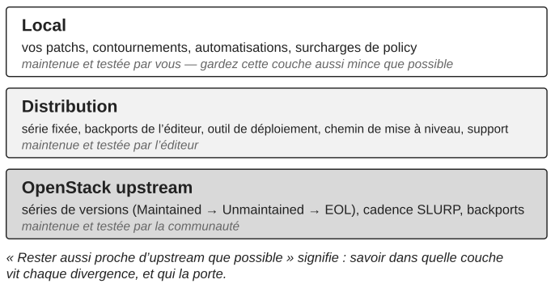

*Partie V — Évoluer sans perdre le contrôle*

# Chapitre 14 — Mises à niveau, backports et alignement upstream

Une plateforme OpenStack ne peut pas rester indéfiniment inchangée. Les versions vieillissent, les exigences de sécurité évoluent, des dépendances cessent d’être maintenues, les modifications locales s’accumulent, et le coût de l’immobilité finit par faire partie du risque. Une mise à niveau change plus que du logiciel : elle change les hypothèses d’exploitation, les dépendances, les procédures, les méthodes de reprise, la supervision et parfois les compétences dont l’équipe a besoin.

Une plateforme qui reste raisonnablement proche de l’OpenStack upstream bénéficie des correctifs de la communauté, de versions maintenues et d’un corpus de connaissance opérationnelle partagé avec les autres opérateurs. Suivre upstream réduit aussi la quantité d’*interprétation* que l’organisation doit fournir : lorsque les ingénieurs investiguent un comportement proche d’upstream, ils peuvent s’appuyer sur la documentation communautaire, les défauts connus, les notes de version et l’expérience des autres, et chaque divergence locale retire une part de cette connaissance commune.

> **Principe.** Rester aussi proche d’upstream que possible en pratique.

## Vocabulaire : maintenu, supporté, rétroporté

Deux mots de cette discussion sont employés de façon approximative par les opérateurs, et il vaut la peine d’être précis à leur sujet une fois pour toutes. Un troisième terme, SLURP, est défini dans la même note parce que la politique de maintenance en dépend.

> **Note technique — ce qu’upstream maintient, et ce que « backport » veut dire.** L’OpenStack upstream ne « supporte » pas des versions ; il *maintient* des branches. Depuis la série 2023.1, une version sur deux est désignée version SLURP (Skip Level Upgrade Release Process) : les mises à niveau sont supportées entre versions SLURP consécutives aussi bien qu’entre versions adjacentes, de sorte qu’un déploiement peut choisir de monter de version une fois par an au lieu de tous les six mois. Une série de versions est **Maintained** (maintenue) pendant environ dix-huit mois, période pendant laquelle les corrections de bugs appropriées sont acceptées et des versions de maintenance sont produites. Selon la politique en vigueur au moment où ce livre est écrit, une série SLURP peut ensuite devenir **Unmaintained** (non maintenue), état dans lequel des correctifs peuvent encore être fusionnés, avec une intégration continue réduite et sans nouvelle version, tant qu’il existe un intérêt dans la communauté, tandis que les séries non SLURP passent directement en **End of Life** (fin de vie), état dans lequel la branche n’accepte plus aucun changement. Lorsqu’une série passe en Unmaintained, sa branche `stable/<series>` est remplacée par une branche `unmaintained/<series>`, ce qui casse tout outillage qui épingle l’ancien nom ; en End of Life, la branche est supprimée et seul un tag subsiste. Cette politique a changé plus d’une fois ces dernières années et doit être vérifiée sur releases.openstack.org avant de s’y fier. Le support commercial, avec ses propres calendriers et ses propres correctifs, vient des distributions et des éditeurs, pas d’upstream. Dans le vocabulaire upstream, un **backport** est un *cherry-pick* d’un correctif déjà fusionné sur la branche master vers une branche stable plus ancienne, soumis à la politique des branches stables : faible risque de régression, bénéfice visible pour l’utilisateur, pas de nouvelle fonctionnalité, pas de changement d’API ou de schéma. Dans ce livre, sauf mention contraire, *backport* désigne quelque chose de plus large et de plus local : un changement porté par la plateforme déployée qui ne fait pas partie de la version qu’elle exécute, qu’il provienne d’un backport upstream sur branche stable, d’une version ultérieure, ou d’un correctif purement local. La distinction compte parce qu’un backport upstream est testé et maintenu par la communauté, alors qu’un backport local est testé et maintenu par vous. Voir la politique des branches stables d’OpenStack et le statut des séries de versions sur releases.openstack.org.

## Un backport est une décision de risque

Rester proche d’upstream n’est pas une interdiction des modifications locales. Un backport peut être raisonnable lorsqu’un défaut doit être traité et qu’une mise à niveau complète créerait un risque immédiat plus grand en production : une version de production stable contient un défaut connu, le correctif existe dans une version plus récente, l’impact du défaut est borné, et la mise à niveau comporte un risque significatif ce trimestre. Le cas le plus légitime est un avis de sécurité (chapitre 17) dont le correctif existe upstream mais pas pour la série que la plateforme exécute. Dans cette situation, un backport contrôlé peut être la bonne décision. Mais c’est une décision de risque, et elle doit être comprise comme une déviation locale avec un propriétaire, une origine, un test et une condition de sortie. Au minimum, l’organisation doit savoir quel problème upstream il traite, de quel changement upstream il dérive, pourquoi la mise à niveau complète n’a pas été choisie, qui est propriétaire de la modification locale, comment elle est testée et quand elle doit être reconsidérée. Un backport sans condition de sortie est une décision que l’organisation a cessé de prendre.

La décision devient dangereuse quand les backports deviennent la stratégie de cycle de vie. Chaque modification locale ajoute un coût de test, de dépannage et de réconciliation, et avec le temps la divergence devient de la dette de contrôle. La question à poser à chaque backport est quel contrôle l’organisation gagne maintenant et quelle dette de contrôle elle accepte plus tard. Le meilleur moment pour en retirer un est généralement une mise à niveau planifiée : la prochaine version maintenue peut le rendre inutile, et traiter les événements de cycle de vie comme des occasions de retirer les déviations locales empêche les décisions de court terme de devenir une divergence permanente.

## Quand une distribution se tient entre vous et upstream

La plupart des plateformes critiques n’exécutent pas directement l’OpenStack upstream. Elles exécutent une distribution commerciale, avec un outil de déploiement, un contrat de support et un cycle de vie propres, et « rester aussi proche d’upstream que possible » a besoin d’être traduit pour ce lecteur. La distribution est elle-même une divergence portée : elle fixe la série de versions, elle applique ses propres backports, et son chemin de mise à niveau supporté peut différer de l’arithmétique SLURP d’upstream, parfois plus long, parfois contraint à la propre séquence de l’éditeur. Rien de cela ne contredit le principe. Les backports de l’éditeur sont testés et maintenus par l’éditeur, ce qui vaut bien mieux que par vous seul ; c’est le calendrier de support de l’éditeur, et non celui d’upstream, qui gouverne le moment où la plateforme doit bouger ; et les modifications locales qui créent de la dette de contrôle sont celles qui s’ajoutent par-dessus la distribution, pas la distribution elle-même. Ce que le principe demande à l’organisation, c’est de savoir où sa plateforme se situe dans trois couches, upstream, distribution et local (figure 14.1), et de garder la troisième couche aussi mince que possible.

Le contrat de support mérite le même examen que toute autre dépendance. Le chapitre 2 disait qu’une relation externe saine accroît la capacité interne avec le temps ; une relation avec un éditeur doit être jugée à ce test. L’organisation doit être capable de dire quelles opérations elle peut effectuer sans ouvrir un ticket, lesquelles elle ne peut pas, et si cette seconde liste se réduit. Elle doit attendre de chaque escalade non seulement un correctif, mais une explication que l’équipe peut réutiliser, et de chaque intervention un transfert de la connaissance opérationnelle concernée. Un éditeur qui est le seul à pouvoir expliquer le comportement de la plateforme, c’est la lacune de contrôle du chapitre 2 avec un logo dessus.

## La stratégie de mise à niveau doit être continue

Les organisations traitent parfois les mises à niveau comme des projets exceptionnels séparés par de longues périodes de stagnation ; l’enquête auprès des utilisateurs d’OpenStack (*User Survey*) publiée par la fondation montre, année après année, des déploiements de production répartis sur de nombreuses séries, y compris certaines qu’upstream ne maintient plus, de sorte que la plateforme de l’exemple du chapitre 18 n’a rien d’inhabituel. Une approche plus saine consiste à maintenir en permanence une direction crédible vers l’état suivant. Cela n’exige pas de monter de version en continu. Cela signifie comprendre le cycle de maintenance, la divergence locale de la plateforme, sa capacité de reprise et la préparation de l’organisation assez tôt pour que la prochaine mise à niveau soit une transition planifiée plutôt qu’une urgence.

*Figure 14.1 : Trois couches entre la plateforme en production et l’OpenStack upstream, et qui maintient chacune d’elles.*

> **Note technique — ce que SLURP promet et ne promet pas.** Les mises à niveau de SLURP à SLURP sont un engagement pris par les projets OpenStack au sujet de leurs propres services : les migrations de schéma et la compatibilité RPC nécessaires pour sauter une version sont maintenues. La promesse s’arrête là. Le système d’exploitation et la version de Python, l’outil de déploiement, RabbitMQ, MariaDB, le backend réseau et le backend de stockage doivent chacun supporter le même saut, et les migrations de données en ligne de la version sautée doivent avoir été achevées, sans quoi la synchronisation de schéma suivante refuse de s’exécuter. Une plateforme en retard de plus d’une version SLURP doit encore passer par chaque version SLURP intermédiaire dans l’ordre. La conséquence pratique pour la décision du chapitre 18 est que « mise à niveau progressive » et « mise à niveau immédiate » ne sont plus des options abstraites : le statut de maintenance de la série courante, le fait qu’elle soit ou non une version SLURP, et l’état des dépendances qui l’entourent déterminent combien de transitions la plateforme doit faire et de combien de temps elle dispose. Vérifiez toujours le statut courant des séries sur releases.openstack.org avant de planifier ; la liste des séries y change deux fois par an, et une nouvelle série SLURP s’y ajoute une fois par an.

## La préparation à la mise à niveau est une préparation organisationnelle, et elle se mesure

Avant une mise à niveau, l’organisation peut passer en revue ses modifications locales non résolues, sa couverture de reprise, sa couverture de test, sa documentation d’exploitation, la capacité disponible, les lacunes de propriété, la préparation des consommateurs et celle de la supervision. Un résultat faible n’annule pas la mise à niveau ; il indique où une préparation est nécessaire. Upstream fournit une partie de la mesure.

> **Note technique — vérifications de mise à niveau et mises à niveau progressives.** Plusieurs projets livrent une commande de vérification préalable à la mise à niveau : `nova-status upgrade check`, `neutron-status upgrade check`, `cinder-status upgrade check` et `placement-status upgrade check` effectuent des contrôles propres à chaque version avant que les services ne soient redémarrés avec le nouveau code, et renvoient un code qui indique si la mise à niveau peut se poursuivre. Nova documente une séquence de mise à niveau progressive conçue pour éviter toute interruption des VM : parce que les migrations de schéma de Nova sont additives, le schéma peut être synchronisé avant la fenêtre de maintenance avec les anciens services encore en marche ; Placement est mis à niveau en premier ; les services sont redémarrés avec `[upgrade_levels]compute=auto`, qui épingle le RPC à la version de compute la plus ancienne trouvée, en commençant par nova-conductor et en terminant par nova-api ; les nœuds de calcul sont mis à niveau par lots ; une fois que chaque compute exécute le nouveau code, les services reçoivent un SIGHUP pour que l’épinglage automatique avance (un épinglage statique doit au contraire être retiré de la configuration et les services redémarrés) ; et les migrations de données en ligne sont achevées ensuite avec `nova-manage db online_data_migrations`, qui est aussi un prérequis strict de la mise à niveau *suivante*. Depuis 2023.1, Nova tolère des computes jusqu’à deux versions plus anciennes que les services de contrôle, et c’est ce qui rend le saut SLURP possible, et les services de contrôle refusent de démarrer s’ils en détectent un plus ancien. D’autres projets suivent leurs propres séquences : les changements de schéma de Neutron sont scindés en une phase d’expansion et une phase de contraction, et la phase de contraction, bien que généralement vide dans les versions récentes, exige que chaque neutron-server soit arrêté. Ces mécanismes ne réduisent le risque de mise à niveau que si l’organisation sait qu’ils existent et les répète ; ils ne suppriment pas le besoin de capacité de reprise, de capacité disponible et de propriété. Voir la documentation de mise à niveau de Nova, celle de Neutron et les références des commandes `*-status`.

La mise à niveau n’est pas terminée quand le nouveau logiciel est déployé. Le nouvel état doit être observé, vérifié et transféré dans l’exploitation normale, et les hypothèses de stabilité précédentes de la plateforme doivent être regagnées (chapitre 9). Les mises à niveau apportent aussi des changements qui ne concernent pas du tout le logiciel : le passage aux politiques d’autorisation RBAC sécurisées par défaut à travers les versions récentes (chapitre 17) a changé qui pouvait faire quoi sur de nombreuses plateformes, et un plan de mise à niveau qui n’inclut pas la politique d’autorisation est incomplet. La plateforme la plus sûre à long terme est celle dont l’organisation peut comprendre et exploiter l’état courant et l’état suivant, qu’elle soit ou non la plus récente.

---

[← Chapitre 13 — Les droits de décision](13-les-droits-de-decision.md) · [Sommaire](../README.md) · [Chapitre 15 — Complexité, dette technique et simplification →](15-complexite-dette-technique-et-simplification.md)
